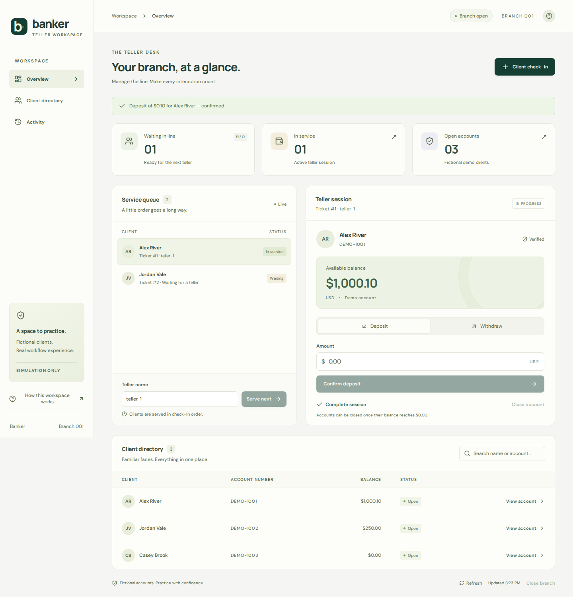

# Banker

A Java bank teller simulation built around a **check-in → FIFO queue → teller session** workflow. The backend persists accounts, queue tickets, exact decimal balances, transaction history, and retry receipts. It evolves the original linked-list coursework into a Spring Boot application; the original source remains in [`legacy/`](legacy/README.md).

**Version 1.0.0:** a React/TypeScript teller workspace backed by Spring Boot, with H2/PostgreSQL persistence, durable retry recovery, and real browser workflow tests.



The **Midnight Fintech** design uses a horizontal command bar, dark navy ledger surfaces, electric-blue transaction controls, and a bold balance card. The responsive dashboard includes a live queue, independent teller sessions, deposits/withdrawals, a searchable client directory, account history, and confirmed account/branch closure. It uses the real API and fictional seed accounts. Fonts ship locally; no CDN or API key is required.

## Quick demo and portfolio guide

See the [three-minute interview demo and resume bullets](docs/demo-guide.md), [release build/verification guide](docs/release.md), and [1.0.0 release notes](docs/release-notes.md).

The portable release ZIP contains the complete UI/API JAR and launch scripts. Extract it, run `start-banker.cmd` on Windows or `sh start-banker.sh` on macOS/Linux, wait for startup, then open http://127.0.0.1:8080. **Java 17+ is required**; Java is not bundled. The launchers keep demo data beside the app, even when launched from another directory. CI prepares a draft release after a validated main-branch merge; it does not publish automatically.

## Build and run locally

Requires **Java 17+, Maven 3.9+, and Node.js 24 LTS** to build the complete application. Python 3 is optional for the API demo script. Once built, the JAR requires only Java; Node is not needed to run it.

```sh
mvn -Pweb clean verify
java -jar target/banker-1.0.0.jar
```

Open **http://127.0.0.1:8080/** for the dashboard; the API is at `/api`. The Maven `web` profile runs `npm ci`, type-checks/builds the frontend, and bundles the static assets into the same JAR. H2 writes to `./data/banker` relative to your working directory; use the same directory when restarting. Flyway applies versioned migrations automatically. There is no separate database installation for this default mode.

To explore: check in **Alex River / DEMO-1001**, select **Serve next**, and try a deposit. Complete the session to free the teller. Use the directory to view current balances and account history. The help button explains the flow. Account closure requires $0.00; branch closure requires an empty queue and no active teller sessions.

If a command's result is uncertain, all new actions pause and a saved-action banner appears. Keep the tab open, or reload it, and choose **Retry saved action**. The original key and payload are kept in that tab's session storage, so a lost response after a successful deposit cannot make a retry deposit again. Do not clear session storage or close an unresolved tab; a new tab is a separate browser session. Browser session storage must be available for mutations.

In another terminal, optionally run the API-only demo:

```sh
curl http://127.0.0.1:8080/api/accounts
python3 scripts/demo.py
```

The script checks in Alex, claims the next ticket, deposits $25, retries that exact deposit, withdraws $10, and completes the session. It changes Alex's balance by $15 and expects an open branch with an empty queue. Repeated runs work after completion.

| Fictional account | Name | Starting balance |
|---|---|---:|
| DEMO-1001 | Alex River | $1,000.00 |
| DEMO-1002 | Jordan Vale | $250.00 |
| DEMO-1003 | Casey Brook | $0.00 |

These are explicitly fictional seeds. The legacy CSV files are never imported. To reset **only a disposable H2 demo**, stop the application and remove `data/`; the next startup recreates it.

## PostgreSQL mode

Start the local database using Docker Compose:

```sh
docker compose up -d --wait
```

Then run the backend with environment variables (Bash example):

```sh
export BANKER_DB_URL=jdbc:postgresql://localhost:5432/banker
export BANKER_DB_USER=banker
export BANKER_DB_PASSWORD=banker-local-demo
java -jar target/banker-1.0.0.jar
```

PowerShell equivalents:

```powershell
$env:BANKER_DB_URL = 'jdbc:postgresql://localhost:5432/banker'
$env:BANKER_DB_USER = 'banker'
$env:BANKER_DB_PASSWORD = 'banker-local-demo'
java -jar target/banker-1.0.0.jar
```

Compose's default password is for local demonstration. If changed in `.env`, set the same value for the application. The PostgreSQL named volume survives `docker compose down`; `docker compose down -v` deletes that disposable database.

## What the core handles

- Account/name verification before check-in; one active ticket per account.
- FIFO claims by ticket sequence, one active session per normalized teller name.
- Deposits, withdrawals, balance/history lookup, session completion, and account closure with zero balance.
- `BigDecimal` and `NUMERIC(15,2)` money; positive amounts, at most two decimal places, no overdrafts or balance overflow.
- Database transactions that commit balance, ledger entry, and idempotency receipt together.
- Durable queue and retry receipts across restarts. An identical UUID-keyed command returns the original response; conflicting reuse returns 409.
- Branch closure blocked while any ticket is waiting or serving; closed branches reject new work until reopened.
- Problem Details responses for invalid input and business conflicts.

## Test

```sh
mvn clean verify
```

For frontend development, run the backend normally and use Vite's API proxy in another terminal:

```sh
mvn spring-boot:run
# separate terminal
cd frontend
npm ci
npm run dev
```

Open `http://127.0.0.1:5173`. Browser requests to `/api` are proxied to localhost:8080 during development; the packaged app uses one origin. The backend-only build remains `mvn clean verify` and does not require Node. Use **clean** when changing build profiles so stale static assets do not survive a previous frontend build.

Frontend/recovery tests and browser workflows:

```sh
npm --prefix frontend ci
npm --prefix frontend test
mvn -Pweb clean verify
cd frontend
npx playwright install chromium
npm run test:e2e
```

Playwright starts the packaged JAR on port 8091 against a fresh in-memory database. Do not start another app on that port. Four sequential browser tests exercise actual HTTP/database behavior, including a dropped response after commit, reload/retry without duplicate deposit, zero-balance closure, mobile layout, native-dialog focus, offline reads, and automated axe checks for desktop/mobile WCAG A/AA rules. Automated checks do not establish complete accessibility conformance.

The same backend suite can exercise a **disposable PostgreSQL test database**:

```sh
export BANKER_TEST_DB_URL=jdbc:postgresql://localhost:5432/banker_test
export BANKER_TEST_DB_USER=banker
export BANKER_TEST_DB_PASSWORD=your-local-test-password
mvn clean verify
```

Tests reset demo rows; never point them at data you want to keep. CI runs separate H2 and PostgreSQL 17 jobs. The H2 job also builds the frontend, runs its tests, exercises the packaged app in Chromium, and uploads the complete JAR plus browser results. Release checks verify the extracted portable ZIP on Linux, Windows, and macOS, including paths with spaces and persisted transaction retries across a server restart. Tests cover concurrent withdrawals/retries/check-ins/claims, FIFO, identity validation, rollback on injected ledger/receipt failures, HTTP errors, exact money arithmetic, and a complete application-context restart against persistent storage.

## Design and scope

`BankController` handles HTTP input, `BankService` owns workflow and transaction boundaries, `BankRepository` owns SQL, and `MoneyRules` holds decimal invariants. Flyway is the only schema initializer. See [API contract](docs/api.md) and [architecture decisions](docs/architecture.md).

This is a **local, fictional bank simulation**, with no authentication or real banking integration. Name matching demonstrates the original workflow; it is not identity security. The backend binds to localhost by default and has no CORS allowance. Public deployment and authentication are outside this portion. The interface labels all data as fictional and does not imply authenticated teller ownership.

## Project history

The coursework version used CSV storage and intrusive linked-list nodes. It had compilation errors, a list insertion bug, and shared account/queue pointers. The current backend replaces those structures with independent persisted accounts and queue tickets while retaining the original teller workflow. The archived source and CSVs are preserved for reference and excluded from the Maven build.
